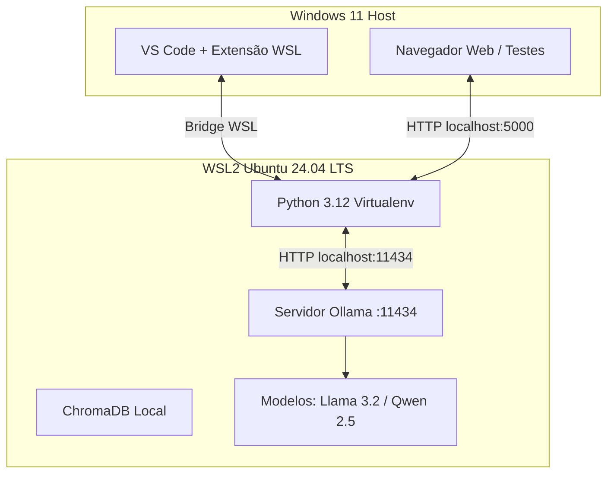

# Aula 000: Nivelamento, Arquitetura de IA Local e Configuração do Ambiente WSL2 + Ollama

- **Unidade Curricular**: UC10 - Criar e Manter Sistemas de Recomendação, Personalização de Conteúdo, Assistentes Virtuais e Chatbots
- **Modalidade**: Presencial (Laboratório de Informática - Senac Lapa Tito)
- **Carga Horária**: 3h30min (19:00 às 22:30)
- **Indicadores do PC**:
  - **Indicador 3**: Cria e mantém assistentes virtuais e chatbots que garantem interações eficientes e naturais com os usuários.
  - **Indicador 7**: Implementa técnicas de processamento de linguagem natural (PLN) para melhorar a interação usuário-máquina em diversos contextos de comunicação.

---

## 1. Visão Geral & Contexto Pedagógico

O objetivo central desta unidade curricular é capacitar você a construir **sistemas de recomendação inteligentes** e **assistentes virtuais autônomos (chatbots)** integrados a sistemas reais de software.

No ecossistema corporativo atual, restrições de privacidade de dados (LGPD), custos de APIs em nuvem e políticas de segurança exigem frequentemente o uso de **Modelos de Linguagem Locais (Local LLMs)**. Como os computadores do laboratório contam com Windows 11 com políticas de segurança restritivas, utilizaremos o **WSL2 (Windows Subsystem for Linux)** rodando **Ubuntu 24.04 LTS** para gerenciar serviços como **Ollama, ChromaDB, Redis e PostgreSQL**, mantendo o **Visual Studio Code** no Windows como nosso ambiente de desenvolvimento.



---

## 3. Conteúdo Teórico & Comandos Práticos

### 3.1 O que é o Ollama?
O **Ollama** é uma ferramenta de código aberto que empacota modelos de linguagem abertos em binários leves e executáveis via linha de comando ou API HTTP REST local na porta `11434`.

### 3.2 Comandos Essenciais no Terminal WSL2
Abra o terminal do Windows e entre no WSL:
```bash
wsl --install Ubuntu
```

Atualize os pacotes e verifique a versão do Python:
```bash
sudo apt update && sudo apt install -y python3-pip python3-venv curl git
python3 --version
```

Instale o Ollama no WSL:
```bash
curl -fsSL https://ollama.com/install.sh | sh
```

Inicie o serviço do Ollama (caso não inicie automaticamente) e baixe o modelo leve:
```bash
ollama serve &
ollama pull gemma4:12b
```

Teste a execução diretamente pelo terminal:
```bash
ollama run gemma4:12b "Olá! Apresente-se brevemente como assistente do Senac."
```

### 3.3 Configurando o Ambiente Python Virtual
No diretório do seu projeto:
```bash
python3 -m venv .venv
source .venv/bin/activate
pip install requests urllib3
```

---

## 4. Referências e Leituras Recomendadas
- Documentação Oficial do Ollama: [https://ollama.com](https://ollama.com)
- Guia Microsoft WSL2: [https://learn.microsoft.com/pt-br/windows/wsl/](https://learn.microsoft.com/pt-br/windows/wsl/)
- SUMIT, R. *Construindo chatbots com Python*. São Paulo: Novatec, 2019.

PS.: Caso precise remover o WSL:

Abra o terminal do Windows e entre no WSL:
```bash
wsl --unregister Ubuntu
```
