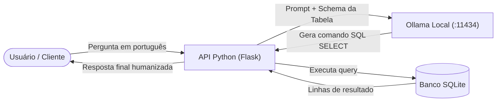

# Aula 005: Text-to-SQL - Consultando Bancos Relacionais com IA


## 1. Visão Geral 



```python
#!/usr/bin/env python3
import os
import sqlite3
import requests
from flask import Flask, jsonify, request

app = Flask(__name__)

BASE_DIR = os.path.dirname(os.path.abspath(__file__))
DB_PATH = os.path.join(BASE_DIR, "_bancoDeDados", "estoque", "controle_estoque.db")

OLLAMA_URL = "http://localhost:11434/api/generate"
MODELO = "gemma4:12b"

SCHEMA = """
Tabela Produtos:
- id (INTEGER)
- nome (TEXT)
- preco (REAL)
- quantidade_estoque (INTEGER)
- fornecedor_id (INTEGER)

Regra de negócio: Estoque baixo significa quantidade_estoque < 40.
"""

def executar_consulta(sql: str):
    with sqlite3.connect(DB_PATH) as conn:
        conn.row_factory = sqlite3.Row
        cur = conn.cursor()
        cur.execute(sql)
        return [dict(r) for r in cur.fetchall()]

@app.route("/api/status", methods=["GET"])
def get_status():
    return jsonify({
        "status": "ok",
        "app": "Controle de Estoque NL-to-SQL API",
        "versao": "1.0.0",
        "owner": "Aecio Brito"
    }), 200

@app.route("/api/consulta-nl", methods=["POST"])
def consultar_nl():
    dados = request.get_json()

    if not dados or "pergunta" not in dados:
        return jsonify({"erro": "Envie o campo 'pergunta' no corpo da requisição."}), 400

    pergunta = dados["pergunta"].strip()
    if not pergunta:
        return jsonify({"erro": "O campo 'pergunta' não pode ser vazio."}), 400

    prompt = f"""Você é um tradutor de linguagem natural para SQL (SQLite).
Com base exclusivamente no esquema abaixo, gere APENAS uma consulta SQL SELECT válida em uma única linha.
Não use blocos de código Markdown nem texto explicativo.

{SCHEMA}

Pergunta: {pergunta}
SQL:"""

    try:
        resp = requests.post(
            OLLAMA_URL,
            json={
                "model": MODELO,
                "prompt": prompt,
                "stream": False,
                "options": {"temperature": 0.1}
            },
            timeout=60
        )

        if resp.status_code != 200:
            return jsonify({"erro": "Falha na resposta do Ollama", "detalhes": resp.text}), 502

        sql_gerado = resp.json().get("response", "").strip()
        sql_gerado = sql_gerado.replace("```sql", "").replace("```", "").strip()

    except requests.exceptions.RequestException as e:
        return jsonify({"erro": f"Erro de conexão com o Ollama: {str(e)}"}), 503

    # Validação de segurança básica pedagógica (apenas SELECT permitido)
    if not sql_gerado.upper().startswith("SELECT"):
        return jsonify({
            "erro": "Apenas comandos de consulta (SELECT) são permitidos por segurança.",
            "sql_gerado": sql_gerado
        }), 400

    try:
        resultados = executar_consulta(sql_gerado)
        return jsonify({
            "pergunta": pergunta,
            "sql_executado": sql_gerado,
            "total_registros": len(resultados),
            "dados": resultados
        }), 200
    except sqlite3.Error as e:
        return jsonify({
            "erro": "Falha de sintaxe ao executar SQL gerado.",
            "sql_gerado": sql_gerado,
            "detalhes": str(e)
        }), 422

if __name__ == "__main__":
    app.run(host="0.0.0.0", port=5002, debug=True)
```

